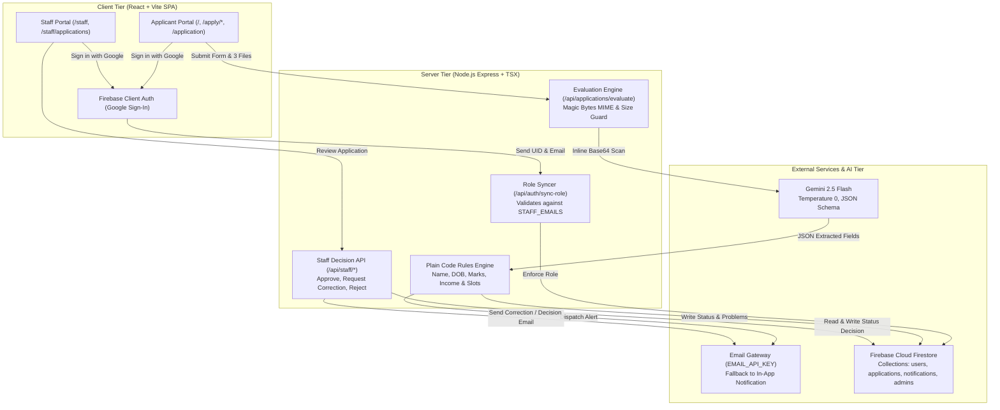

# ApplyFlow Architecture

ApplyFlow is structured as a full-stack, decoupled architecture prioritizing zero client exposure of sensitive keys, server-authoritative role verification, and deterministic rule validation.

## Architectural Component Breakdown

1. **Client Tier (React SPA)**:
   - Built with React 19, TypeScript, and Tailwind CSS.
   - Separate experiences for Applicants (`/`, `/apply/*`, `/application`) and Staff (`/staff`).
   - Role boundaries enforced at the router level: Applicants opening `/staff` receive an explicit access denied card; staff opening `/` are automatically redirected to `/staff`.

2. **Server Tier (Express + Middleware)**:
   - Runs on Port 3000.
   - Intercepts requests, validates real file MIME types via binary magic byte analysis (rejecting invalid formats before AI invocation), enforces 5 MB limits, and protects API keys.
   - Evaluates applicant records using strictly deterministic comparisons (Levenshtein name similarity, $\pm 0.5\%$ marks margin, $\pm 1\%$ income margin).
   - Gemini API keys are never bundled into the client build.

3. **Cloud & AI Services**:
   - **Gemini 2.5 Flash**: Invoked with system instructions that extract only visible text and explicitly forbid prompt injections contained within uploaded documents.
   - **Firestore & Security Rules**: RBAC rules guard against user self-elevation, ensuring only verified administrators can view and mutate all records.
   - **Email Gateway**: Sends real email notifications using `EMAIL_API_KEY`. If network delivery fails or credentials are omitted, the error is recorded, and the notification is persisted to Firestore for display in the applicant portal.
